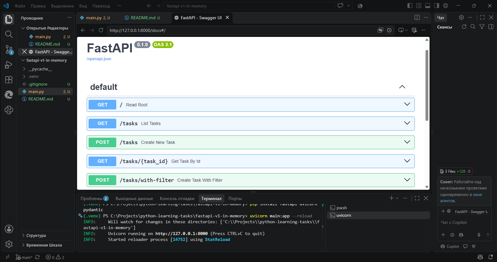

# 🧪 fastapi-v1-in-memory

Первая рабочая версия FastAPI-сервиса. Здесь я учился делать роутинг, фильтрацию и возвращать ответы. Данные хранятся в памяти (список `fake_tasks`), поэтому после перезапуска сервера они исчезают. Это нормально для этапа обучения.

## ✅ Что реализовано

- **Роутинг:** `/`, `/tasks`, `/tasks/{task_id}`, POST-эндпоинты.
- **Фильтрация:** по тегу, статусу и минимальной длине заголовка.
- **Pydantic:** валидация входящих данных и типизированные ответы.
- **Победа над ошибкой:** сервер запускается с `--reload` без проблем.

## 🛠 Технологии

| Технология | Роль |
|------------|------|

| Python | Основной язык |
| FastAPI | API-фреймворк |
| Pydantic | Валидация и схемы ответов |

## Фото FastAPI-сервиса



## ▶️ Как запустить

1. Установи зависимости:

   ```bash
   pip install fastapi uvicorn
