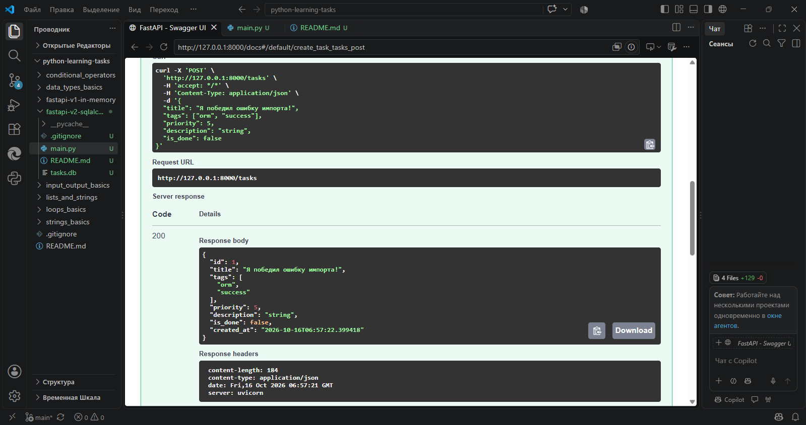

# 🗄️ fastapi-v2-sqlalchemy — Persistent API с настоящей базой данных

Это вторая версия моего FastAPI-проекта: я заменил фейковые списки (`fake_tasks`) на **реальную базу данных** с помощью SQLAlchemy ORM. Теперь данные не исчезают после перезапуска сервера — они живут в файле `tasks.db`. 😎

Этот модуль — мой переход от «прототипа» к настоящему бэкенду. Он показывает, что я понимаю разницу между in-memory и persistent-хранилищем, умею описывать модели и работать с сессиями.

## ✅ Что реализовано

- **SQLAlchemy ORM** — таблицы как классы Python: `class Task(Base)`.
- **Модели и типы** — колонки описаны как атрибуты с типами: `Integer`, `String`, `Boolean`, `DateTime`.
- **Persistent storage** — данные сохраняются в SQLite (`tasks.db`) и остаются после рестарта.
- **Автоматические поля** — `created_at` заполняется автоматически, `is_done` по умолчанию `False`.
- **CRUD-логика** — базовый CRUD (Create уже есть, дальше добавлю Read/Update/Delete).
- **Валидация и типизация** — Pydantic-модели для запросов и ответов.

## 🧱 Архитектура в двух словах

| Компонент | Роль |
|--------|------|

| `Base = declarative_base()` | Базовый класс для всех моделей. |
| `class Task(Base)` | Модель-таблица: колонки → атрибуты класса. |
| `Column(Integer, primary_key=True)` | ID: уникальный ключ, автоинкремент. |
| `Column(DateTime, default=datetime.utcnow)` | Дата создания: подставляется сама. |
| `SessionLocal()` | Сессия БД: «мост» между Python и базой. |
| `db.add() + db.commit() + db.refresh()` | Полный цикл сохранения объекта. |



## 🚀 Как запустить

1. Установи зависимости:

   ```bash
   pip install fastapi uvicorn sqlalchemy
